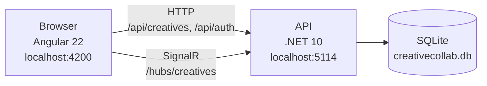
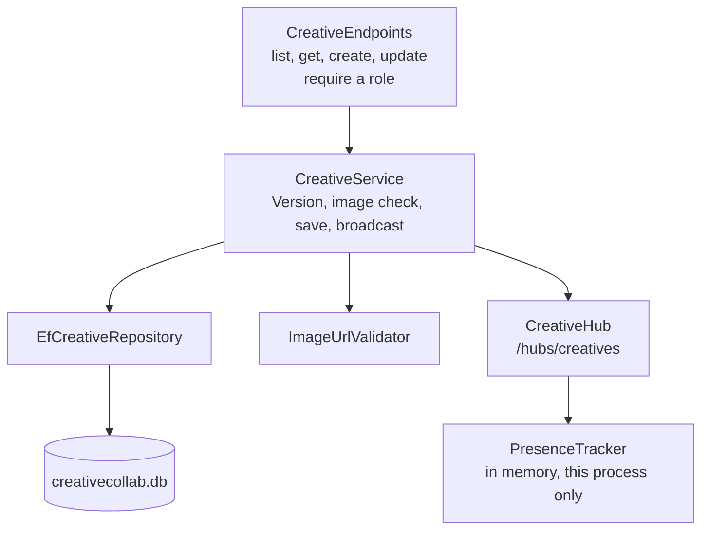
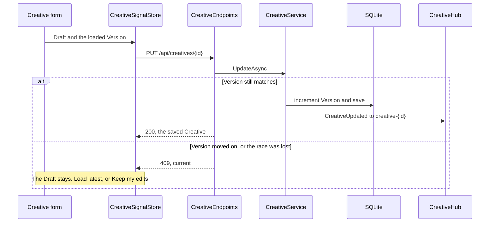
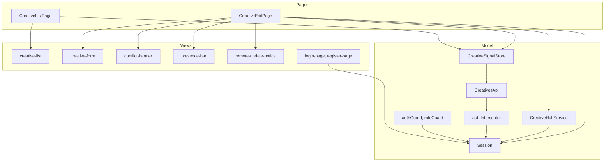

# Architecture

> **v2 almost done.** The API and the Angular app both run on JWT accounts and roles ([ADR 0003](adr/0003-authenticated-collaborators-with-jwt.md)). What remains is slice #20: the Playwright suite in `e2e/` still drives the v1 Display name flow and has not been moved to two real accounts, and the live connection does not yet renew its token after a long drop before it reconnects. Remove this note when #20 lands. See [evolution](evolution.md) for v1 vs v2, and [archive/v1](archive/v1/architecture.md) for the frozen v1 copy.

CreativeCollab is one API and one Angular app. The API owns the Creative. The browser owns the Draft. A save sends the Version the Collaborator loaded. The API accepts it or returns a Conflict.

The diagrams below are the system that runs today. The rules under them are the ones the code follows. [PLAN.md](../PLAN.md) records why those rules were chosen.

## The running system

Two browsers can open the same Creative. Each one talks to the same API. The API is the only writer of the Creative.



| Part | What it is |
|---|---|
| Browser | One Collaborator's Angular app. It keeps the Draft, the signed-in session (the access token, in memory only), and the open SignalR connection. A second tab is a second browser in this picture, and Presence counts it separately |
| API | The only process that accepts a save, decides a Conflict, checks an image URL, and tells other open sessions what happened |
| SQLite | The Creative rows. `creativecollab.db` sits next to the API project and is gitignored. Version is the concurrency token. Development migrates and, when the table is empty, seeds three Creatives |

Inside the API, a save goes through the service. Endpoints do not hold the rules.



| Part | What it is |
|---|---|
| CreativeEndpoints | The HTTP surface. Each route requires a policy. It turns a result into 200, 201, 400, 404, or 409 and passes the caller's name claim to the service |
| CreativeService | The rules. It creates at Version 1, rejects a stale Version, increments Version on a successful save, and broadcasts after that save |
| EfCreativeRepository | EF Core 10. A lost race becomes `DbUpdateConcurrencyException`, which the service reports as the same Conflict |
| ImageUrlValidator | The outbound check for a new or changed image URL. Public addresses only, no redirects, 3 seconds, `image/*` only |
| CreativeHub | Requires a role. The real-time group `creative-{id}`. Join and leave announce Presence under the account's name. A successful update pushes `CreativeUpdated` |
| PresenceTracker | Who has the Creative open, one account name per connection. Lost on restart. One API process only |

## A save

The form never talks to the API. The edit page asks the store to save. The store sends the Version the Collaborator loaded.



Load latest discards the Draft and shows `current`. Keep my edits is a Rebase: changed fields keep the Draft, unchanged fields take `current`, and the store saves again with `current`'s Version.

A `CreativeUpdated` event for this Creative reaches every open edit page, including the one that just saved. A clean form adopts it. A dirty Draft stays, and the page offers to load the latest. The list page is not on the hub.

## API, file by file

| Piece | Where | Behaviour |
|---|---|---|
| Host | `backend/CreativeCollab.Api/Program.cs` | Wires TimeProvider, the DbContext, Identity, JWT bearer validation, the rate limiter, the image-check client, the repository, the service, and FluentValidation. In Development only, applies migrations and seeds. In every environment, creates the first Admin when `Admin:*` is configured |
| HTTP | `Endpoints/CreativeEndpoints.cs` | `GET /api/creatives` and `GET /api/creatives/{id}` (policy `CanRead`), `POST /api/creatives` and `PUT /api/creatives/{id}` (policy `CanEdit`). The request bodies carry no name |
| Rules | `Services/CreativeService.cs` | Creates a Creative at Version 1. Update checks the supplied Version, increments it, stamps `updatedAt` from TimeProvider, records the caller's account name (the `name` claim, handed in by the endpoint) as `updatedBy`. A stale Version, or a store that rejects the compare-and-swap, is a Conflict carrying the latest Creative |
| Store | `Data/EfCreativeRepository.cs`, `Data/CreativeDbContext.cs` | EF Core 10 on SQLite. The connection string `ConnectionStrings:Creatives` defaults to `Data Source=creativecollab.db` (gitignored). Version is a concurrency token, so a save that loses a race raises `DbUpdateConcurrencyException`, which the repository reports as not updated and the service turns into the same Conflict. `updatedAt` is stored as UTC ticks so it sorts. Scoped lifetime |
| Hub | `Hubs/CreativeHub.cs`, `Hubs/PresenceTracker.cs` | `/hubs/creatives`. `JoinCreative(id)` returns the account names present (one per connection, sorted) and sends `UserJoined` to the others in group `creative-{id}`. `LeaveCreative(id)` and a dropped connection send `UserLeft` to the others. The hub requires the `CanRead` policy and the name comes from the caller's `name` claim, never from an argument. The tracker is a singleton keyed by connection id with no scoped dependencies. Single instance, no backplane: ADR 0002 |
| Broadcast | `Services/CreativeService.cs` | After a successful update the service sends `CreativeUpdated` (the full Creative) to the group through `IHubContext<CreativeHub>`, sender included. A failed push is logged and does not fail the save. Create does not broadcast |
| Image check | `Services/ImageUrlValidator.cs`, `Services/PublicAddress.cs` | Typed client from `IHttpClientFactory` (pooled handler, no redirects, 3 s timeout from `ImageValidation:Timeout`). Runs on create and on update only when the image URL is new or changed, after the Version check. Resolves the host, refuses any non-public address, sends HEAD, then a one-byte ranged GET if HEAD is not successful. Only `image/*` passes. Every failure is a 400 on `imageUrl`. DNS rebinding is not fully mitigated: the host is resolved again when the client connects |
| Accounts | `Endpoints/AuthEndpoints.cs`, `Auth/` | `POST /api/auth/register` (email, password, Display name; 201, role Editor), `POST /api/auth/login`, `POST /api/auth/refresh`, `POST /api/auth/logout`, and `GET /api/auth/me` (the claims of the caller). ASP.NET Core Identity runs on `CreativeDbContext`; `RefreshTokens` sits beside it. Roles Viewer, Editor and Admin are seeded by the migration. The first Admin comes from `Admin:Email`, `Admin:Password`, `Admin:DisplayName` and is created once. Password: 12 characters minimum, no composition rules. Five failed sign-ins lock the account for 15 minutes (423 with a clear message); every other failure is one generic 401. Register, login and refresh are rate limited per client address and endpoint (`RateLimiting:Auth`, default 10 a minute, 429). `GET /api/auth/me` and `POST /api/auth/logout` need a valid token, any role. `PUT /api/admin/users/{id}/role` (policy `CanAdminister`, body `{ "role": "Viewer" }`) sets an account's one role: 204, 400 for an unknown role, 404 for an unknown account. There is no screen for it |
| Tokens | `Auth/TokenService.cs`, `Auth/JwtBearerSetup.cs`, `Auth/SessionService.cs` | The access token is an HS256 JWT valid 15 minutes with claims `sub`, `name`, `role`, `jti`. Validation pins HS256 and checks issuer, audience and lifetime with 30 seconds of skew. The key is `Jwt:Key` (at least 32 bytes): user-secrets in development, `Jwt__Key` in production, never appsettings. The API refuses to start without it. The refresh token is opaque, stored as a SHA-256 hash, and rotated on every use. Presenting a used or revoked token revokes its family. It travels in the `refresh_token` cookie: HttpOnly, Secure, SameSite=Strict, path `/api/auth`. Logout revokes the family. Roles are read again on refresh, so a role change reaches the token at its next refresh and not before. For the hub, a connection stays authorized until it drops and reconnecting uses a fresh token. The JWT bearer handler also accepts the token as the `access_token` query value on `/hubs` paths only (browsers cannot set headers on WebSocket or event-stream connections); anywhere else the query value is ignored |
| Policies | `Auth/Policies.cs` | `CanRead` (Viewer, Editor, Admin), `CanEdit` (Editor, Admin), `CanAdminister` (Admin). Roles build on each other. A valid token with no known role is authenticated but forbidden |
| Errors | `Infrastructure/GlobalExceptionHandler.cs` | An unhandled exception is logged and answered as a 500 `ProblemDetails` with a generic title and no detail, in every environment. Request-binding errors such as malformed JSON keep their 4xx |
| CORS | `Program.cs`, `Cors:AllowedOrigins` in `appsettings.json` | Default policy for `http://localhost:4200` with credentials. Any other origin gets no CORS headers |
| Migrations and seed | `Data/Migrations/`, `Data/DatabaseInitializer.cs` | Development only: migrate on startup, then add three Creatives with empty `updatedBy` if the table is empty |
| Validation | `Validation/` | Create and update share one rule set; update also requires Version >= 1. Empty required fields, max lengths, and a non-http(s) image URL return 400 `ValidationProblemDetails` |
| Tests | `backend/CreativeCollab.Api.Tests` | xUnit and `WebApplicationFactory` on in-memory SQLite with the real migrations. A fake TimeProvider controls time. Every test host starts with a real Admin account; helpers register accounts, set roles through the Admin endpoint, and sign them in. Tests use the real tokens, with no bypass; the signing key is test configuration, not appsettings. A save interceptor stages a genuine race. A file database and two hosts prove a restart |

A stale update returns 409 `ProblemDetails` with the latest Creative in `current`. The Angular app in `frontend/` is tested against mocked HTTP and a fake hub.

Development listens on `http://localhost:5114` (`Properties/launchSettings.json`).

```bash
dotnet test backend/CreativeCollab.slnx
dotnet run --project backend/CreativeCollab.Api
```

## Rules

Endpoints stay thin. The rules live in the service, the store, and the hub client.

| Concern | Rule |
|---|---|
| Concurrency | Integer Version, not a rowversion. Stale save and `DbUpdateConcurrencyException` both return 409 with the latest Creative in `current`. See [ADR 0001](adr/0001-optimistic-concurrency-with-integer-version.md) |
| Live updates | Hub `/hubs/creatives`, sign-in required. `JoinCreative(id)`, `LeaveCreative(id)`. Events `CreativeUpdated`, `UserJoined`, `UserLeft`. The list page is not live |
| Presence | Singleton `ConcurrentDictionary` keyed by connection id. Lost on restart. One server instance. See [ADR 0002](adr/0002-single-instance-in-memory-presence.md) |
| Image | Only when `imageUrl` changes. `image/*` only. Three-second timeout. No redirects. Loopback, private, and link-local addresses are rejected. Failure is 400. DNS rebinding is not fully closed |
| Identity | See [ADR 0003](adr/0003-authenticated-collaborators-with-jwt.md). Every API and hub call requires a valid access token except register, login and refresh. `updatedBy` and Presence names come from the token's `name` claim on the server. The client cannot supply or override them. Older `updatedBy` values stay as plain text with no link to an account |
| Roles | Viewer reads, Editor creates and updates, Admin also changes roles. The API enforces them with policies; the UI only mirrors them (guards, a hidden New Creative link, a read-only form) |
| CORS | `http://localhost:4200` with credentials, because SignalR needs it. The Angular app calls the API directly |
| Frontend | Angular 22, standalone, Signals, OnPush. Screen state lives in `CreativeSignalStore`; who is signed in lives in `Session`. Presentational components take `input()` and `output()` only. A dirty form is never overwritten by `CreativeUpdated` |
| Session | The access token is held in a signal only, never in localStorage or sessionStorage, so a reload starts signed out and one silent refresh on load restores the session from the refresh cookie. The browser never sends a name: the API reads it from the token. The UI reads the name and roles from the token for display only; guards and hidden buttons are UX, the API decides |

## Frontend today

`frontend/` is an Angular 22 app (standalone, Signals). Screen state is an NgRx signal store (`@ngrx/signals`), not a Redux store and not a service. Angular 22 makes OnPush the default, so no component sets it. Logic specs (session, interceptor, guards, store, hub client, API client, app wiring) and the edit page spec run on Vitest through `ng test`, with HTTP mocked by `HttpTestingController`, so no API is needed. The other components, the list page and the login and register screens are tested in a real browser with Playwright component tests (`*.ct.ts`, `@sand4rt/experimental-ct-angular`, [ADR 0005](adr/0005-experimental-playwright-component-testing.md)); the pages answer HTTP with `page.route`. Playwright in `e2e/` drives two browsers against the running API. The API is called directly at `http://localhost:5114` (`core/api-config.ts`).

Routes: `/login`, `/register`, `/creatives` (list), `/creatives/new`, and `/creatives/:id` (the same edit page). `authGuard` protects the list and `/creatives/:id`; `roleGuard('Editor')` protects `/creatives/new`. A signed-out visitor goes to `/login?returnUrl=...` and returns there after signing in. A Viewer who opens `/creatives/new` is sent to the list; one who opens a Creative sees it read-only, with live updates and Presence. The page is the controller. The store, the API client, and the hub client are the model. The components under them are views: they take inputs and emit outputs, and they do not call the API.



| Part | What it is |
|---|---|
| CreativeListPage | Loads the list and navigates to a Creative. It does not join the hub |
| CreativeEditPage | Loads one Creative or starts a new one, joins its group, and decides what the views are allowed to show |
| CreativeSignalStore | An NgRx signal store for the list, the selected Creative, loading, saving, errors, the Conflict, and a remote update that arrived while the form was dirty |
| CreativesApi | HTTP for the four endpoints. It sends the loaded Version on update and no name |
| CreativeHubService | The SignalR connection, authorized with the in-memory token. `presence` is who has this Creative open. `updated` is `CreativeUpdated` |
| Session | The signed-in Collaborator: access token in memory, name and roles read from it, sign in, register, silent refresh, sign out |
| authInterceptor | Adds the bearer token to API requests, renews once on a 401 and retries once |
| authGuard, roleGuard | Keep a signed-out visitor, or a Viewer on an Editor page, off a route. UX only |
| login-page, register-page | The sign-in and registration screens. Register signs in afterwards, because the API does not |
| creative-form | The Draft. It emits field changes and resets only when handed a different Creative |
| conflict-banner | Load latest, or Keep my edits |
| presence-bar | The sentence of Display names. Empty means the bar renders nothing |
| remote-update-notice | The offer to load a newer Creative without throwing away a dirty Draft |

```bash
cd frontend && npm install && npm start     # http://localhost:4200
cd frontend && npm test -- --watch=false    # Vitest
cd frontend && npm run test:ct:install      # once: Chromium for the component tests
cd frontend && npm run test:ct              # Playwright component tests
```

| Piece | Where | Behaviour |
|---|---|---|
| `Session` | `core/session.ts` | Holds the access token in a signal, never in web storage. `name`, `roles`, `isSignedIn` and `canEdit` are read from the token's claims (unverified, for display). `hasRole` treats the roles as a ladder (Admin may do what an Editor may). `signIn`, `register` (create the account, then sign in), `restore` (one refresh on load, never fails), `refresh` (concurrent callers share one request; a refusal clears the session) and `signOut` (logout on the server, then clear; clears even when the server is unreachable). Login, refresh and logout use `withCredentials` for the refresh cookie. Failures become an `AuthError` carrying the API's message (the generic 401, the 423 lockout) or field messages from a 400 |
| `authInterceptor` | `core/auth-interceptor.ts` | A functional `HttpInterceptorFn`. Adds `Authorization: Bearer` only to requests to `API_ORIGIN`, and never to login, register or refresh (which answer 401 for their own reasons). A 401 renews through `Session.refresh` (shared by concurrent requests, skipped when another request already renewed) and retries the request once with the new token. If renewal fails, or the retry is a 401 again, it clears the session and navigates to `/login?returnUrl=` |
| `authGuard`, `roleGuard` | `core/guards.ts` | `canActivate` functions. `authGuard` needs a signed-in session. `roleGuard(role)` needs that role or a higher one: signed out goes to login, signed in without the role goes to the list. The app initializer in `app.config.ts` restores the session before the first route is guarded |
| `CreativesApi` | `core/creatives-api.ts` | One method per endpoint. Adds the loaded Version to update and no name; the API takes it from the token. An empty image URL is omitted |
| `CreativeSignalStore` | `core/creative-signal-store.ts` | `signalStore` state: `creatives`, `selected`, `loading`, `saving`, `error`, `conflict`, `remoteUpdate`. `receiveUpdate(creative, formIsDirty)` ignores other Creatives and Versions not newer than the selected, pending or Conflict copy, ignores my own echo (`updatedBy` equals the account name) while a save is in flight, adopts the update when the form is clean, and otherwise keeps it as `remoteUpdate` without touching the form. A save result never moves `selected` backwards. A 409 with `current` sets `conflict` (not `error`) and leaves `selected` as the Version the Collaborator loaded. `loadLatest` adopts `conflict`; `keepMyEdits` Rebases and saves with `current.version`. Turns HTTP failures into network, not-found, forbidden (403), validation (field messages) or server errors. A newer load cancels an older one |
| `CreativeListPage`, `CreativeEditPage` | `creatives/` | Containers. The edit page serves `/creatives/new` and `/creatives/:id`. They show loading, error with retry, and the form. A Collaborator who cannot edit gets no New Creative link and a read-only form with no Save |
| `CreativeHubService` | `core/creative-hub.ts` | Wraps the SignalR connection (built by an injectable factory so tests use a fake; the real one reads the token from `Session` through `accessTokenFactory` on every connect and reconnect). `join(id)` invokes `JoinCreative` with the id only and exposes `presence` (one account name per session; `UserJoined` adds one, `UserLeft` removes one). `updated` streams `CreativeUpdated`. It rejoins after a reconnect, `unavailable` is set when the connection fails, and `dispose` leaves the group and stops the connection |
| `Rebase` | `core/rebase.ts` | Pure function: fields where the Draft differs from the loaded Creative keep the Draft value, all others take the latest. An empty and an absent image URL are equal |
| `creative-list`, `creative-form`, `conflict-banner`, `presence-bar`, `remote-update-notice` | `creatives/` | Presentational: `input()` and `output()` only. The form emits its Draft as it changes and resets only when handed a different Creative; with `readOnly` its fields are disabled and it has no Save |

On a Conflict the Draft stays in the form and the banner names who saved (`current.updatedBy`). It offers Load latest and Keep my edits, with no merge or diff UI.

While the form has a Draft, a `CreativeUpdated` event shows a non-blocking notice ("X updated this Creative, load latest?") that tracks the newest Version heard about. The Draft is still saved with the Version the Collaborator loaded, so a stale save goes through the Conflict flow instead of overwriting. The edit page joins on open, leaves and disposes on destroy, and the list page is not live.

## Folders

| Path | May do | Must not do |
|---|---|---|
| `Endpoints/` | Map routes, translate results | Hold business rules |
| `Services/` | Version check, save, broadcast, image check | Talk HTTP details or know about Angular |
| `Data/` | Persist and query Creatives | Validate input or broadcast |
| `Hubs/` | Group membership and Presence | Save a Creative |
| `Validation/` | Shape of a request | Decide a Conflict |
| `frontend/` | Draft, Conflict UI, hub client, session | Invent a second Version rule, keep a token in web storage, send a name |

No second backend project. The test project is the only sibling of the API.

## Failure rules

| Situation | Response |
|---|---|
| Unknown id | 404 |
| Invalid create body | 400 `ValidationProblemDetails` |
| Stale Version | 409, body includes `current` |
| Image URL that is not a public image | 400 on `imageUrl` |
| No token, or an expired, tampered or wrongly signed token | 401 (hub negotiate too) |
| A valid token whose role may not do this (a Viewer saving, an Editor changing roles, a token with no role) | 403 |
| Wrong email or password, bad refresh token | 401, one generic message |
| Account locked after 5 failed sign-ins | 423 |
| Too many register, login or refresh requests | 429 |
| Invalid registration (short password, taken or invalid email, no Display name) | 400 `ValidationProblemDetails` |
| Unexpected exception | 500 ProblemDetails with no internals |

There is no delete.
