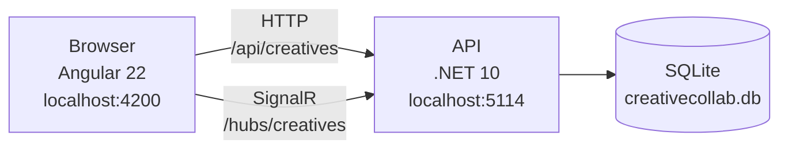
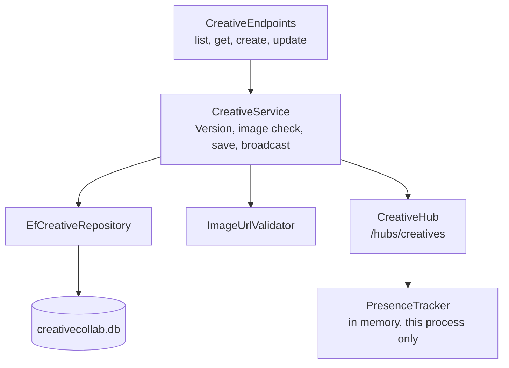
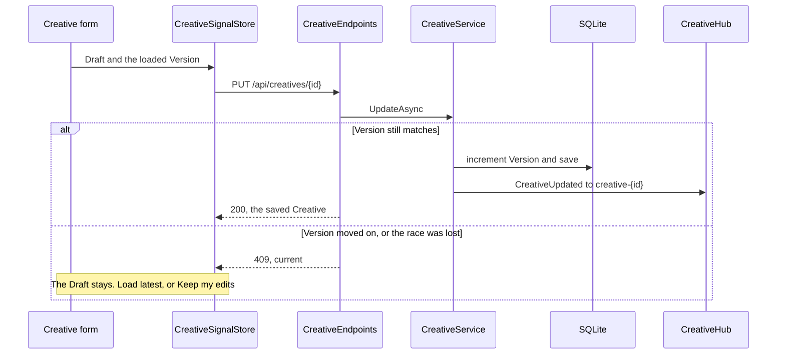
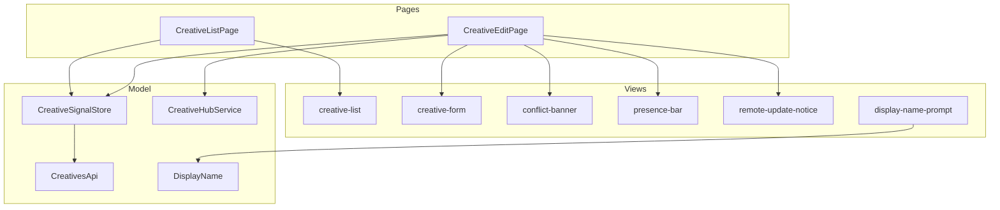

> **Superseded.** This is the v1 architecture (unauthenticated Display name, localStorage), frozen at git tag `v1-display-name`. The current design is in [ADR 0003](../../adr/0003-authenticated-collaborators-with-jwt.md); see [evolution](../../evolution.md) for the comparison.

# Architecture

CreativeCollab is one API and one Angular app. The API owns the Creative. The browser owns the Draft. A save sends the Version the Collaborator loaded. The API accepts it or returns a Conflict.

The diagrams below are the system that runs today. The rules under them are the ones the code follows. [PLAN.md](../../../PLAN.md) records why those rules were chosen.

## The running system

Two browsers can open the same Creative. Each one talks to the same API. The API is the only writer of the Creative.



| Part | What it is |
|---|---|
| Browser | One Collaborator's Angular app. It keeps the Draft, the Display name, and the open SignalR connection. A second tab is a second browser in this picture, and Presence counts it separately |
| API | The only process that accepts a save, decides a Conflict, checks an image URL, and tells other open sessions what happened |
| SQLite | The Creative rows. `creativecollab.db` sits next to the API project and is gitignored. Version is the concurrency token. Development migrates and, when the table is empty, seeds three Creatives |

Inside the API, a save goes through the service. Endpoints do not hold the rules.



| Part | What it is |
|---|---|
| CreativeEndpoints | The HTTP surface. It turns a result into 200, 201, 400, 404, or 409 |
| CreativeService | The rules. It creates at Version 1, rejects a stale Version, increments Version on a successful save, and broadcasts after that save |
| EfCreativeRepository | EF Core 10. A lost race becomes `DbUpdateConcurrencyException`, which the service reports as the same Conflict |
| ImageUrlValidator | The outbound check for a new or changed image URL. Public addresses only, no redirects, 3 seconds, `image/*` only |
| CreativeHub | The real-time group `creative-{id}`. Join and leave announce Presence. A successful update pushes `CreativeUpdated` |
| PresenceTracker | Who has the Creative open, one Display name per connection. Lost on restart. One API process only |

## A save

The form never talks to the API. The edit page asks the store to save. The store sends the Version the Collaborator loaded.



Load latest discards the Draft and shows `current`. Keep my edits is a Rebase: changed fields keep the Draft, unchanged fields take `current`, and the store saves again with `current`'s Version.

A `CreativeUpdated` event for this Creative reaches every open edit page, including the one that just saved. A clean form adopts it. A dirty Draft stays, and the page offers to load the latest. The list page is not on the hub.

## API, file by file

| Piece | Where | Behaviour |
|---|---|---|
| Host | `backend/CreativeCollab.Api/Program.cs` | Wires TimeProvider, the DbContext, the image-check client, the repository, the service, and FluentValidation. In Development only, applies migrations and seeds |
| HTTP | `Endpoints/CreativeEndpoints.cs` | `GET /api/creatives`, `GET /api/creatives/{id}`, `POST /api/creatives`, `PUT /api/creatives/{id}` |
| Rules | `Services/CreativeService.cs` | Creates a Creative at Version 1. Update checks the supplied Version, increments it, stamps `updatedAt` from TimeProvider, records the Display name. A stale Version, or a store that rejects the compare-and-swap, is a Conflict carrying the latest Creative |
| Store | `Data/EfCreativeRepository.cs`, `Data/CreativeDbContext.cs` | EF Core 10 on SQLite. The connection string `ConnectionStrings:Creatives` defaults to `Data Source=creativecollab.db` (gitignored). Version is a concurrency token, so a save that loses a race raises `DbUpdateConcurrencyException`, which the repository reports as not updated and the service turns into the same Conflict. `updatedAt` is stored as UTC ticks so it sorts. Scoped lifetime |
| Hub | `Hubs/CreativeHub.cs`, `Hubs/PresenceTracker.cs` | `/hubs/creatives`. `JoinCreative(id, userName)` returns the Display names present (one per connection, sorted) and sends `UserJoined` to the others in group `creative-{id}`. `LeaveCreative(id)` and a dropped connection send `UserLeft` to the others. A blank name is a `HubException`. The tracker is a singleton keyed by connection id with no scoped dependencies. Single instance, no backplane: ADR 0002 |
| Broadcast | `Services/CreativeService.cs` | After a successful update the service sends `CreativeUpdated` (the full Creative) to the group through `IHubContext<CreativeHub>`, sender included. A failed push is logged and does not fail the save. Create does not broadcast |
| Image check | `Services/ImageUrlValidator.cs`, `Services/PublicAddress.cs` | Typed client from `IHttpClientFactory` (pooled handler, no redirects, 3 s timeout from `ImageValidation:Timeout`). Runs on create and on update only when the image URL is new or changed, after the Version check. Resolves the host, refuses any non-public address, sends HEAD, then a one-byte ranged GET if HEAD is not successful. Only `image/*` passes. Every failure is a 400 on `imageUrl`. DNS rebinding is not fully mitigated: the host is resolved again when the client connects |
| Errors | `Infrastructure/GlobalExceptionHandler.cs` | An unhandled exception is logged and answered as a 500 `ProblemDetails` with a generic title and no detail, in every environment. Request-binding errors such as malformed JSON keep their 4xx |
| CORS | `Program.cs`, `Cors:AllowedOrigins` in `appsettings.json` | Default policy for `http://localhost:4200` with credentials. Any other origin gets no CORS headers |
| Migrations and seed | `Data/Migrations/`, `Data/DatabaseInitializer.cs` | Development only: migrate on startup, then add three Creatives with empty `updatedBy` if the table is empty |
| Validation | `Validation/` | Create and update share one rule set; update also requires Version >= 1. Empty required fields, max lengths, and a non-http(s) image URL return 400 `ValidationProblemDetails` |
| Tests | `backend/CreativeCollab.Api.Tests` | xUnit and `WebApplicationFactory` on in-memory SQLite with the real migrations. A fake TimeProvider controls time. A save interceptor stages a genuine race. A file database and two hosts prove a restart |

A stale update returns 409 `ProblemDetails` with the latest Creative in `current`. The Angular app in `frontend/` is tested against mocked HTTP and a fake hub.

Development listens on `http://localhost:5114` (`Properties/launchSettings.json`).

```bash
dotnet test backend/CreativeCollab.slnx
dotnet run --project backend/CreativeCollab.Api
```

## Rules

Endpoints stay thin. The rules live in the service, the store, and the hub client.

| Concern | Rule |
|---|---|
| Concurrency | Integer Version, not a rowversion. Stale save and `DbUpdateConcurrencyException` both return 409 with the latest Creative in `current`. See [ADR 0001](../../adr/0001-optimistic-concurrency-with-integer-version.md) |
| Live updates | Hub `/hubs/creatives`. `JoinCreative`, `LeaveCreative`. Events `CreativeUpdated`, `UserJoined`, `UserLeft`. The list page is not live |
| Presence | Singleton `ConcurrentDictionary` keyed by connection id. Lost on restart. One server instance. See [ADR 0002](../../adr/0002-single-instance-in-memory-presence.md) |
| Image | Only when `imageUrl` changes. `image/*` only. Three-second timeout. No redirects. Loopback, private, and link-local addresses are rejected. Failure is 400. DNS rebinding is not fully closed |
| Identity | Display name from the client. Trusted, not authenticated. Required on create and update |
| CORS | `http://localhost:4200` with credentials, because SignalR needs it. The Angular app calls the API directly |
| Frontend | Angular 22, standalone, Signals, OnPush. Screen state lives in `CreativeSignalStore`. Presentational components take `input()` and `output()` only. A dirty form is never overwritten by `CreativeUpdated` |

## Frontend today

`frontend/` is an Angular 22 app (standalone, Signals). Screen state is an NgRx signal store (`@ngrx/signals`), not a Redux store and not a service. Angular 22 makes OnPush the default, so no component sets it. Tests run on Vitest through `ng test`, with HTTP mocked by `HttpTestingController`, so no API is needed. Playwright in `e2e/` drives two browsers against the running API. The API is called directly at `http://localhost:5114` (`core/api-config.ts`).

Routes: `/creatives` (list), `/creatives/new`, and `/creatives/:id` (the same edit page). The page is the controller. The store, the API client, and the hub client are the model. The components under them are views: they take inputs and emit outputs, and they do not call the API.



| Part | What it is |
|---|---|
| CreativeListPage | Loads the list and navigates to a Creative. It does not join the hub |
| CreativeEditPage | Loads one Creative or starts a new one, joins its group, and decides what the views are allowed to show |
| CreativeSignalStore | An NgRx signal store for the list, the selected Creative, loading, saving, errors, the Conflict, and a remote update that arrived while the form was dirty |
| CreativesApi | HTTP for the four endpoints. It attaches the Display name and, on update, the loaded Version |
| CreativeHubService | The SignalR connection. `presence` is who has this Creative open. `updated` is `CreativeUpdated` |
| DisplayName | The name in localStorage. The prompt is the view; this service is the memory |
| creative-form | The Draft. It emits field changes and resets only when handed a different Creative |
| conflict-banner | Load latest, or Keep my edits |
| presence-bar | The sentence of Display names. Empty means the bar renders nothing |
| remote-update-notice | The offer to load a newer Creative without throwing away a dirty Draft |

```bash
cd frontend && npm install && npm start     # http://localhost:4200
cd frontend && npm test -- --watch=false
```

| Piece | Where | Behaviour |
|---|---|---|
| `DisplayName` | `core/display-name.ts` | The Collaborator's Display name in localStorage. Trusted, not authenticated. The shell shows a prompt until it is set and lets it be changed |
| `CreativesApi` | `core/creatives-api.ts` | One method per endpoint. Adds the Display name to create and update, and the loaded Version to update. An empty image URL is omitted |
| `CreativeSignalStore` | `core/creative-signal-store.ts` | `signalStore` state: `creatives`, `selected`, `loading`, `saving`, `error`, `conflict`, `remoteUpdate`. `receiveUpdate(creative, formIsDirty)` ignores other Creatives and Versions not newer than the selected, pending or Conflict copy, ignores my own echo while a save is in flight, adopts the update when the form is clean, and otherwise keeps it as `remoteUpdate` without touching the form. A save result never moves `selected` backwards. A 409 with `current` sets `conflict` (not `error`) and leaves `selected` as the Version the Collaborator loaded. `loadLatest` adopts `conflict`; `keepMyEdits` Rebases and saves with `current.version`. Turns HTTP failures into network, not-found, validation (field messages) or server errors. A newer load cancels an older one |
| `CreativeListPage`, `CreativeEditPage` | `creatives/` | Containers. The edit page serves `/creatives/new` and `/creatives/:id`. They show loading, error with retry, and the form |
| `CreativeHubService` | `core/creative-hub.ts` | Wraps the SignalR connection (built by an injectable factory so tests use a fake). `join(id, name)` invokes `JoinCreative` and exposes `presence` (one name per session; `UserJoined` adds one, `UserLeft` removes one). `updated` streams `CreativeUpdated`. It rejoins after a reconnect, `unavailable` is set when the connection fails, and `dispose` leaves the group and stops the connection |
| `Rebase` | `core/rebase.ts` | Pure function: fields where the Draft differs from the loaded Creative keep the Draft value, all others take the latest. An empty and an absent image URL are equal |
| `creative-list`, `creative-form`, `conflict-banner`, `presence-bar`, `remote-update-notice`, `display-name-prompt` | `creatives/`, `display-name-prompt/` | Presentational: `input()` and `output()` only. The form emits its Draft as it changes and resets only when handed a different Creative |

On a Conflict the Draft stays in the form and the banner names who saved (`current.updatedBy`). It offers Load latest and Keep my edits, with no merge or diff UI.

While the form has a Draft, a `CreativeUpdated` event shows a non-blocking notice ("X updated this Creative, load latest?") that tracks the newest Version heard about. The Draft is still saved with the Version the Collaborator loaded, so a stale save goes through the Conflict flow instead of overwriting. The edit page joins on open, leaves and disposes on destroy, and the list page is not live.

## Folders

| Path | May do | Must not do |
|---|---|---|
| `Endpoints/` | Map routes, translate results | Hold business rules |
| `Services/` | Version check, save, broadcast, image check | Talk HTTP details or know about Angular |
| `Data/` | Persist and query Creatives | Validate input or broadcast |
| `Hubs/` | Group membership and Presence | Save a Creative |
| `Validation/` | Shape of a request | Decide a Conflict |
| `frontend/` | Draft, Conflict UI, hub client | Invent a second Version rule |

No second backend project. The test project is the only sibling of the API.

## Failure rules

| Situation | Response |
|---|---|
| Unknown id | 404 |
| Invalid create body | 400 `ValidationProblemDetails` |
| Stale Version | 409, body includes `current` |
| Image URL that is not a public image | 400 on `imageUrl` |
| Unexpected exception | 500 ProblemDetails with no internals |

There is no delete.
